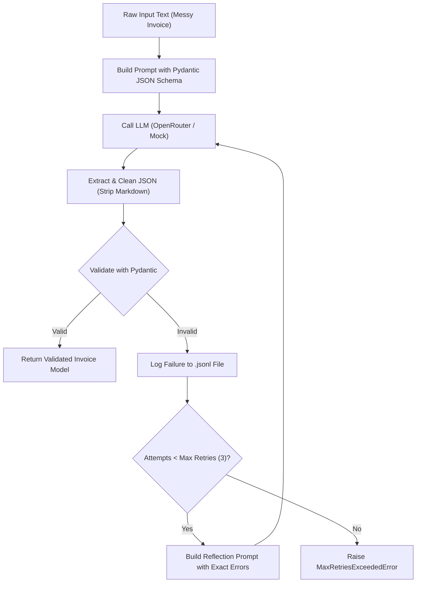

# Project 1: Structured Output Agent in Python

A production-grade, self-healing **Structured Output Agent** that transforms messy, unstructured text (such as invoices, receipts, and order emails) into strictly validated, type-safe Python data structures using **Pydantic** and **LLM Error-Reflection Loops**.

---

## 📖 The Core Problem & Solution

### The Problem
Large Language Models (LLMs) output non-deterministic text strings. In production applications, strings fail silently:
* Missing required fields.
* Numbers formatted as strings (e.g. `"$45.00"` instead of `45.0`).
* Negative quantities or negative prices (violating schema constraints).
* Markdown noise wrapping JSON objects (e.g., ````json { ... } ````).

### The Solution: Error-Reflection Self-Healing Loop
Instead of crashing when the LLM makes a formatting mistake, this agent intercepts validation errors, feeds the exact compiler/validator feedback back to the LLM, and allows it to self-correct in real time.



---

## 🏗️ Architecture & Component Breakdown

The codebase is organized into clean, single-responsibility modules:

```
structured_output_agent/
├── schemas.py              # Pydantic data contracts (Invoice, LineItem, Tool schemas)
├── logger.py               # Structured failure logger writing to validation_failures.jsonl
├── llm_client.py           # Pluggable OpenRouter & Mock LLM clients
├── validator.py            # Self-healing retry engine & tool response validator
├── agent.py                # High-level agent orchestrator & built-in tools
├── tests/
│   ├── __init__.py
│   └── test_agent.py       # 7 pytest test scenarios
├── .env.example            # Environment template for OpenRouter configuration
└── README.md               # Documentation & design guide
```

### 1. `schemas.py`: Data Contracts
Defines the strict rules of validity:
* **`LineItem`**: Enforces positive quantities (`gt=0`), non-negative prices (`ge=0`), and non-empty item descriptions.
* **`Invoice`**: Validates vendor names, dates, line items list (`min_length=1`), subtotal, tax, and total amount.
* **`TaxCalculationResult` & `VendorVerificationResult`**: Dedicated schemas to enforce the same validation standards on tool responses.

### 2. `logger.py`: Audit Trail
Records every single validation failure to `validation_failures.jsonl`.
Each log record contains:
* `timestamp`: ISO-8601 UTC timestamp.
* `attempt`: Which attempt failed (1, 2, 3).
* `schema_name`: Target schema being validated.
* `input_data`: Prompt sent to the model.
* `bad_output`: Raw invalid response from the model.
* `error_details`: Exact Pydantic validation error breakdown.

### 3. `llm_client.py`: Pluggable Model Communication
* **`OpenRouterLLMClient`**: Connects to OpenRouter using OpenAI-compatible endpoints. Defaults to the free model `nvidia/nemotron-3-super-120b-a12b:free`. Configurable dynamically via `.env`.
* **`MockLLMClient`**: Pre-scripted client that returns specific responses in order. Enables deterministic, instant, zero-cost unit testing without requiring internet access or API tokens.

### 4. `validator.py`: Self-Healing Engine
* **`extract_json_string()`**: Uses regex to reliably extract JSON payloads from markdown code blocks or conversational text.
* **`validate_with_retry()`**: Coordinates the prompt → LLM call → Pydantic check → reflection feedback cycle.
* **`validate_tool_response()`**: Enforces schema validation and retries on tool functions.

### 5. `agent.py`: High-Level Orchestrator
Provides simple, developer-friendly methods:
* `agent.extract_invoice(messy_text) -> Invoice`
* `agent.execute_tool(tool_fn, tool_kwargs, schema_class) -> ValidatedModel`

---

## ⚙️ Configuration (`.env`)

To use your live OpenRouter API key and model:

1. Copy `.env.example` to `.env`:
   ```bash
   cp structured_output_agent/.env.example .env
   ```

2. Add your OpenRouter API key:
   ```ini
   OPENROUTER_API_KEY=sk-or-v1-your-actual-api-key
   OPENROUTER_MODEL=nvidia/nemotron-3-super-120b-a12b:free
   OPENROUTER_BASE_URL=https://openrouter.ai/api/v1
   ```

You can switch models at any time (e.g. to `meta-llama/llama-3.3-70b-instruct:free` or `anthropic/claude-3.5-sonnet`) simply by changing `OPENROUTER_MODEL` in `.env`.

---

## 🚀 Running the Project

### 1. Run the Live Demonstration
Extracts an invoice from messy text and executes a validated tax calculation tool:
```powershell
python -m structured_output_agent.agent
```

### 2. Launch the Streamlit Web UI (Visual Prompt Box & Image Uploader)
Provides an interactive web dashboard with a text prompt box, receipt photo uploader, model switcher, and live error log viewer:
```powershell
streamlit run structured_output_agent/app.py
```

### 3. Interactive Terminal Prompt (CLI)
Paste multi-line text directly in your PowerShell terminal:
```powershell
python -m structured_output_agent.cli
```

### 4. Run the Pytest Test Suite
Tests all required validation flows (good input, bad input exhausted, retry recovery, tool validation, failure logging):
```powershell
python -m pytest structured_output_agent/tests/test_agent.py -v
```

**Results:**
```text
collected 7 items

structured_output_agent/tests/test_agent.py::test_good_input PASSED                     [ 14%]
structured_output_agent/tests/test_agent.py::test_retry_success PASSED                  [ 28%]
structured_output_agent/tests/test_agent.py::test_bad_input_retry_exhausted PASSED     [ 42%]
structured_output_agent/tests/test_agent.py::test_markdown_fenced_json_extraction PASSED[ 57%]
structured_output_agent/tests/test_agent.py::test_tool_response_validation_success PASSED[ 71%]
structured_output_agent/tests/test_agent.py::test_tool_response_validation_failure_and_retry PASSED [ 85%]
structured_output_agent/tests/test_agent.py::test_tool_response_validation_exhausted PASSED [100%]

============================== 7 passed in 3.46s ==============================
```

---

## 🛡️ "What Could Go Wrong" & How We Solved It

| Failure Mode | Risk | Our Solution |
| :--- | :--- | :--- |
| **Markdown Fences** | LLMs wrap JSON in ````json ... ```` which crashes `json.loads()`. | `extract_json_string()` uses regex to unwrap fences before parsing. |
| **Invalid Schema Types** | LLM outputs strings for numbers or omits required fields. | Pydantic detects the exact path, and `build_feedback_prompt()` feeds it back to the LLM to fix. |
| **Infinite Retry Loops** | If an LLM cannot fix an error, it could loop forever and burn credits. | Hard cap of `max_retries=3`. Raises `MaxRetriesExceededError` if unrecoverable. |
| **Windows Console Crashes** | Windows terminals using `cp1252` crash when printing Unicode emojis. | Added `sys.stdout.reconfigure(encoding="utf-8")` and resilient ASCII status tags `[SUCCESS]` / `[ERROR]`. |
| **HTTPX / OpenAI Incompatibilities** | Newer `httpx 0.28+` conflicts with older OpenAI SDK client constructors. | Passed custom `httpx.Client()` explicitly to ensure forward compatibility. |
| **Flaky / Expensive Tests** | Tests requiring live API keys fail when offline, run slowly, or cost money. | All automated tests use `MockLLMClient` to run deterministically in < 4 seconds. |
